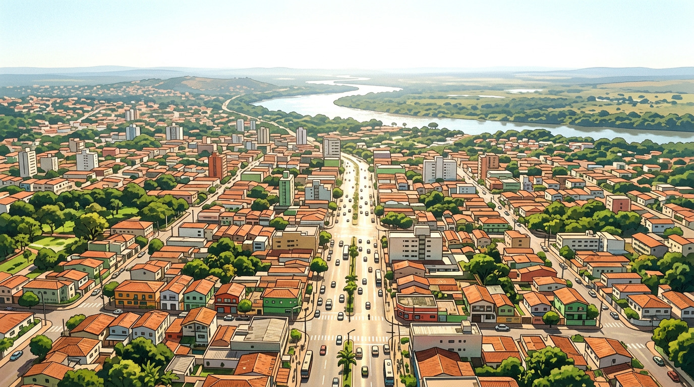
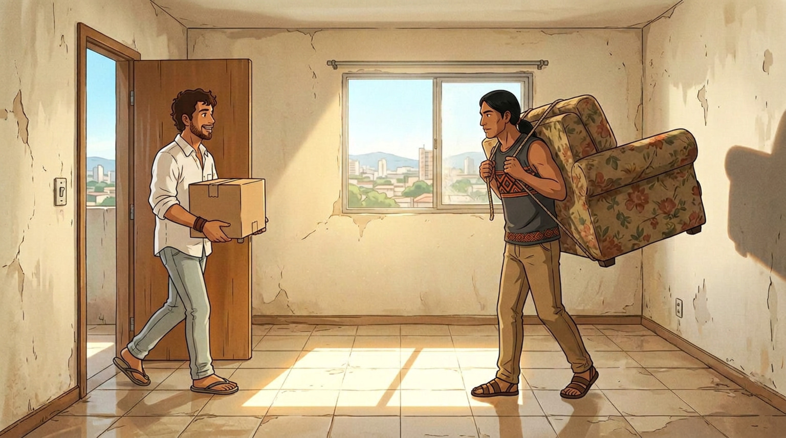
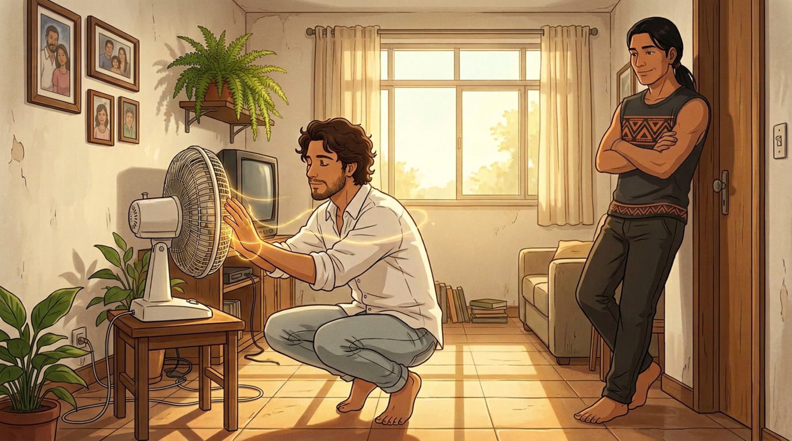
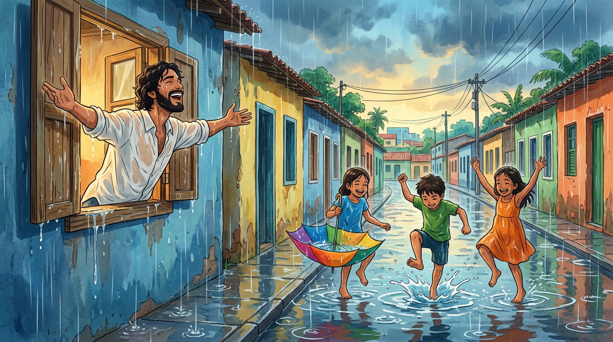
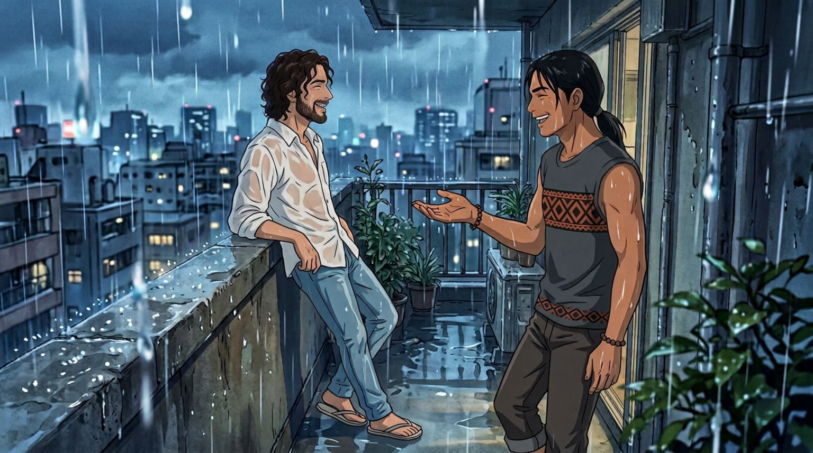

# EPISÓDIO 01 — QUARENTA GRAUS
**Formato:** 5 clipes × 8 s = **40 s** (16:9, 24–30 fps)
**Sinopse:** Primeiro dia no 302. Cuiabá a 41 °C, o ventilador morre, Jesus tenta resolver com fé. Tupã resolve com chuva.

> **Como usar:** o **frame** já está pronto e linkado. Copie o **prompt do vídeo** e cole no Seedance 2.5 / Veo junto com a imagem (modo *image-to-video*, 8 s, áudio ligado).

---

## CLIPE 01 — `00:00 – 00:08` | A CIDADE QUE FERVE

**Cena:** Plano aéreo de Cuiabá ao meio-dia. Ondas de calor sobem do asfalto. A câmera desce devagar e encontra o **Edifício Ipê Amarelo** — prédio de três andares, azulejo branco velho, caminhão de mudança na porta, caixas de papelão na calçada. Uma delas tem um abacaxi saindo.
**Câmera:** drone descendo (plano aéreo → plano médio da fachada), movimento contínuo e lento.
**Áudio:** cigarras, trânsito distante, zumbido de calor, depois o motor do caminhão morrendo.



**Prompt da imagem (frame):**
```text
Plano aéreo amplo de Cuiabá, Mato Grosso, ao meio-dia: telhados de terracota, prédios baixos, avenida larga com carros pequenos, árvores de cerrado, o rio Cuiabá ao fundo brilhando, ondas de calor distorcendo o asfalto, céu branco-azulado estourado de luz. ESTILO: anime cinematográfico 2D, cel shading limpo, traço fino, fundo pintado à mão no estilo Ghibli x A-1 Pictures, luz brasileira quente, cores saturadas, grão de filme suave, 16:9, sem texto, sem letreiro, sem logo, sem legenda.
```

**Prompt do vídeo (8 s):**
```text
Plano aéreo de Cuiabá ao meio-dia com calor extremo; a câmera desce lentamente e sem cortes na direção de um prédio residencial de três andares de azulejo branco velho, parando na fachada, onde um caminhão de mudança velho está estacionado e caixas de papelão se empilham na calçada de chão batido, uma delas aberta com um abacaxi. O ar tremula sobre o asfalto. Movimento único e contínuo de descida, sem cortes. SOM: cigarras altas, trânsito distante, zumbido de calor, motor de caminhão morrendo. ESTILO: anime cinematográfico 2D, cel shading limpo, traço fino, fundo pintado à mão estilo Ghibli x A-1 Pictures, cores saturadas, luz dourada e dura, 16:9. SEM texto, SEM legenda.
```

---

## CLIPE 02 — `00:08 – 00:16` | DOIS CARAS E UMA CAIXA

**Cena:** Sala vazia do 302, cerâmica bege, paredes descascadas, sol entrando pela janela sem cortina. **Jesus** entra falando sem parar com uma caixa nos braços. **Tupã** atravessa o quadro **carregando um sofá nas costas**, sozinho, sem esforço.
**Câmera:** travelling lateral acompanhando os dois, na altura do peito.
**Áudio:** Jesus: *"Essa caixa tem dois mil anos e um liquidificador."* Tupã, sem parar de andar: *"Põe na sala."*



**Prompt da imagem (frame):**
```text
Interior de apartamento vazio em Cuiabá: sala pequena de piso de cerâmica bege, paredes descascadas, janela sem cortina com sol forte entrando e projetando retângulo de luz no chão. JESUS: homem brasileiro de 30 anos, pele morena clara, cabelo castanho-escuro cacheado na altura da nuca, barba curta, camisa de linho branca de botão com mangas dobradas, calça jeans clara, chinelo de dedo, pulseira de couro no pulso — entra sorrindo com uma caixa de papelão nos braços. TUPÃ: homem indígena de 30 anos, pele morena, rosto COMPLETAMENTE BARBEADO, sem barba, sem bigode, sem cavanhaque, sem tatuagens nos braços, cabelo preto liso na altura dos ombros preso em rabo de cavalo baixo, camiseta regata cinza-escura com UMA faixa horizontal de grafismo geométrico guarani atravessada no peito (losangos e zigue-zagues em terracota e preto) e o mesmo motivo pequeno repetido na barra inferior, calça de sarja, sandália de couro, pulseira de sementes — atravessa a sala carregando um sofá velho nas costas, tranquilo. ESTILO: anime cinematográfico 2D, cel shading limpo, traço fino, fundo pintado à mão no estilo Ghibli x A-1 Pictures, luz brasileira quente, cores saturadas, grão de filme suave, 16:9, sem texto, sem letreiro, sem logo, sem legenda.
```

**Prompt do vídeo (8 s):**
```text
Sala vazia de apartamento com sol entrando pela janela. JESUS (camisa de linho branca, cabelo cacheado, barba curta) entra pela porta falando empolgado com uma caixa de papelão nos braços; TUPÃ (camiseta regata cinza-escura com faixa de grafismo guarani no peito, cabelo preto preso) atravessa o quadro de um lado ao outro com um sofá nas costas, sem esforço. Câmera travelling lateral lenta acompanhando o movimento, sem cortes. FALA JESUS: "Essa caixa tem dois mil anos e um liquidificador." FALA TUPÃ, sem parar: "Põe na sala." SOM: passos na cerâmica, caixa rangendo, cigarras pela janela. ESTILO: anime cinematográfico 2D, cel shading limpo, fundo pintado à mão, cores quentes, 16:9. SEM legenda.
```

---

## CLIPE 03 — `00:16 – 00:24` | O MILAGRE NÃO PEGA

**Cena:** **Jesus** agachado na frente do ventilador velho, mãos espalmadas na grade, olhos fechados, um **fio de luz dourada** contornando os dedos — e nada acontece. **Tupã**, encostado no batente, de braços cruzados, solta o ar pelo nariz, quase um riso.
**Câmera:** plano médio lateral, fixo, aproximação muito lenta.
**Áudio:** Jesus: *"Ventilador abençoado não gira."* Silêncio quente. Cigarra.



**Prompt da imagem (frame):**
```text
Sala de apartamento popular, luz quente de fim de tarde pela janela. JESUS: homem brasileiro de 30 anos, pele morena clara, cabelo castanho-escuro cacheado na altura da nuca, barba curta, camisa de linho branca de botão com mangas dobradas, calça jeans clara — descalço, agachado de frente para um ventilador de mesa antigo, mãos espalmadas sobre a grade, olhos fechados, com um fio de luz dourada contornando os dedos. TUPÃ: homem indígena de 30 anos, rosto completamente barbeado, sem barba e sem tatuagens nos braços, cabelo preto liso preso em rabo de cavalo baixo, camiseta regata cinza-escura com UMA faixa horizontal de grafismo geométrico guarani atravessada no peito (losangos e zigue-zagues em terracota e preto) e o mesmo motivo pequeno repetido na barra inferior, calça de sarja, pulseira de sementes, descalço — encostado no batente da porta, braços cruzados, meio-sorriso paciente. Parede com porta-retratos de família, samambaia pendurada e uma TV antiga pequena na estante; paredes domésticas comuns, SEM cruz, SEM crucifixo, SEM imagem religiosa. Sombras longas no piso de cerâmica. ESTILO: anime cinematográfico 2D, cel shading limpo, traço fino, fundo pintado à mão no estilo Ghibli x A-1 Pictures, cores saturadas, grão de filme suave, 16:9, sem texto, sem letreiro, sem logo, sem legenda.
```

**Prompt do vídeo (8 s):**
```text
JESUS, de camisa de linho branca, agachado diante do ventilador velho com as mãos sobre a grade e os olhos fechados; um fio de luz dourada percorre seus dedos, brilha mais forte e se apaga — o ventilador não gira. TUPÃ, de camiseta regata cinza-escura com faixa de grafismo guarani no peito, observa encostado no batente, cruza os braços e solta o ar pelo nariz com um meio-sorriso. Câmera fixa com aproximação muito lenta. FALA JESUS: "Ventilador abençoado não gira." SOM: silêncio quente, cigarras, um estalo de ventilador tentando ligar. ESTILO: anime cinematográfico 2D, cel shading limpo, fundo pintado à mão, cores quentes, 16:9. SEM legenda.
```

---

## CLIPE 04 — `00:24 – 00:32` | A CHUVA DE TUPÃ

**Cena:** O céu escurece em dois segundos. As nuvens engolem o sol. **A chuva desaba** e a rua vira espelho. **Crianças descalças** pulam nas poças, uma com guarda-chuva virado. Na janela, **Jesus** abre os braços e vira o rosto para cima, rindo, encharcado.
**Câmera:** plano geral da rua na altura da calçada; os respingos em câmera lenta leve.
**Áudio:** vento subindo, primeira gota no zinco, depois chuva pesada, risadas de criança. Nenhuma fala.



**Prompt da imagem (frame):**
```text
Rua de bairro em Cuiabá debaixo de chuva forte: asfalto virando espelho, poças com respingos, casas baixas e muros coloridos. Três crianças descalças dançando na chuva, uma com um guarda-chuva virado. Em primeiro plano lateral, na janela do prédio, JESUS (homem de 30 anos, cabelo cacheado castanho, barba curta, camisa de linho branca encharcada) com os braços abertos e o rosto virado para cima, rindo. Luz azul-acinzentada da tempestade com respingos dourados. ESTILO: anime cinematográfico 2D, cel shading limpo, traço fino, pintado à mão no estilo Ghibli x A-1 Pictures, cores saturadas, grão de filme suave, 16:9, sem texto, sem letreiro, sem logo, sem legenda.
```

**Prompt do vídeo (8 s):**
```text
Chuva forte cai de repente sobre uma rua de bairro em Cuiabá: as poças explodem em respingos, três crianças descalças pulam e giram na chuva, uma delas com um guarda-chuva virado. Na janela lateral, JESUS abre os braços e vira o rosto para cima, rindo, encharcado. Câmera fixa na altura da calçada, respingos em câmera lenta leve, sem cortes. SOM: vento subindo, gota forte no zinco, chuva pesada, risadas infantis, latido distante. SEM FALA. ESTILO: anime cinematográfico 2D, cel shading limpo, pintado à mão, luz azul-acinzentada, 16:9. SEM legenda.
```

---

## CLIPE 05 — `00:32 – 00:40` | MOLHADOS, RINDO

**Cena:** Varanda pequena, chuva passando. Os dois encostados na mureta, encharcados. **Tupã** estende a mão aberta na chuva, sentindo as gotas. **Jesus** olha para ele e fala. Tupã não responde — mas o canto da boca sobe. A chuva afina, o sol volta baixo e dourado, e no fim do clipe o **arco-íris** aparece sobre os telhados. **Cartela de título.**
**Câmera:** plano médio dos dois de perfil, chuva desfocada em primeiro plano; no fim, leve tilt up para o céu.
**Áudio:** Jesus: *"Você pediu chuva."* Tupã: *"Você pediu ventilador."* Depois, viola de cocho entrando.



**Prompt da imagem (frame):**
```text
Varanda pequena de apartamento com mureta de concreto molhada e piso escorregadio. JESUS (30 anos, cabelo cacheado castanho-escuro, barba curta, camisa de linho branca encharcada colada, calça jeans, chinelo) e TUPÃ (30 anos, cabelo preto liso preso em rabo de cavalo, camiseta regata cinza-escura com faixa de grafismo guarani no peito encharcada, pulseira de sementes) encostados na mureta, de perfil, encharcados e rindo. Tupã estende a mão aberta na chuva. Gotas em primeiro plano desfocadas. Céu azul-chumbo ao fundo. ESTILO: anime cinematográfico 2D, cel shading limpo, traço fino, pintado à mão no estilo Ghibli x A-1 Pictures, cores saturadas, grão de filme suave, 16:9, sem texto, sem letreiro, sem logo, sem legenda.
```

**Prompt do vídeo (8 s):**
```text
Na varanda encharcada, JESUS e TUPÃ encostados na mureta, de perfil, rindo. Tupã estende a mão aberta e deixa a chuva bater na palma; Jesus vira o rosto para ele e fala. A chuva vai afinando, o sol dourado volta baixo entre as nuvens e um arco-íris fraco aparece sobre os telhados molhados. Gotas desfocadas em primeiro plano. Câmera fixa com leve handheld, terminando em tilt up suave para o céu. FALA JESUS: "Você pediu chuva." FALA TUPÃ: "Você pediu ventilador." SOM: chuva diminuindo, grilos, trilha de viola de cocho entrando. ESTILO: anime cinematográfico 2D, cel shading limpo, pintado à mão, 16:9. SEM legenda.
```

---

## FICHA DO EPISÓDIO 01

| Item | Valor |
|---|---|
| Duração | 40 s (5 × 8 s) |
| Falas | 5 |
| Frames prontos | 5 de 5 ✅ |
| Frames alternativos | `imagens/ep01/alternativas/` (5 extras, caso queira trocar) |
| Trilha | viola de cocho + percussão de água |
| Gancho para o Ep. 02 | o pão de queijo do café da manhã |

**Cartela final (adicione na edição, não no prompt):**
> **SANTOS DO CERRADO** — Ep. 1: *Quarenta Graus*
