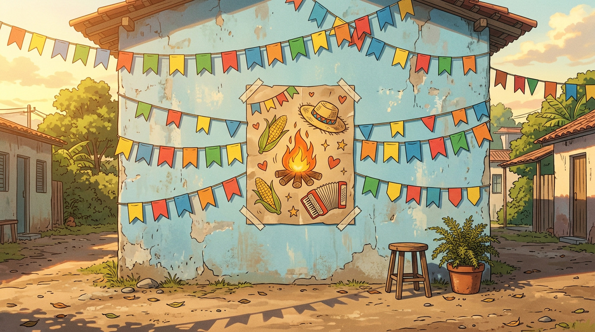
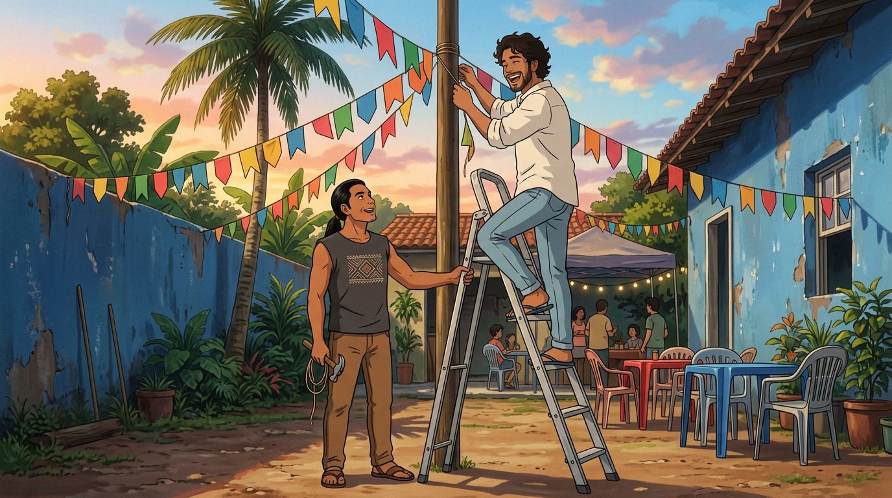
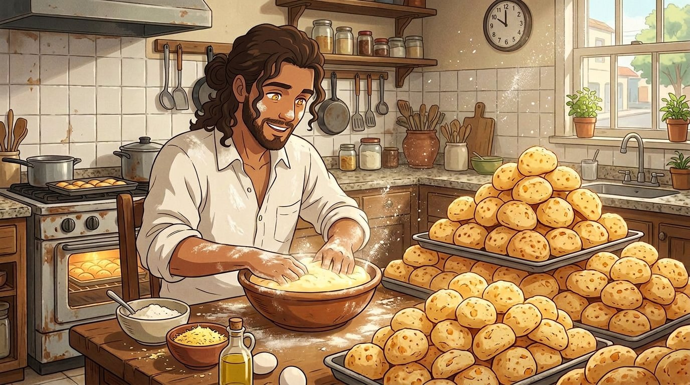
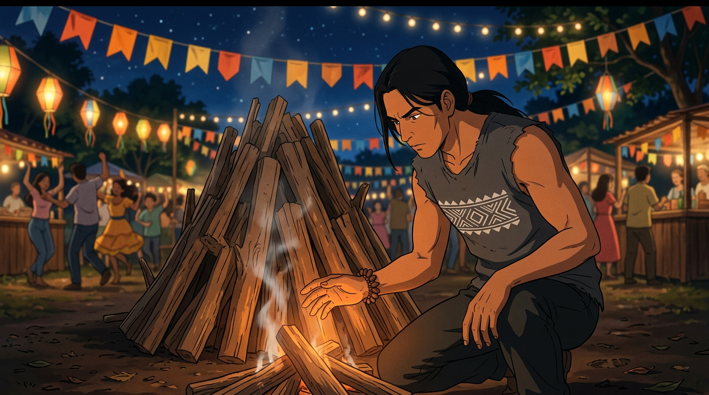
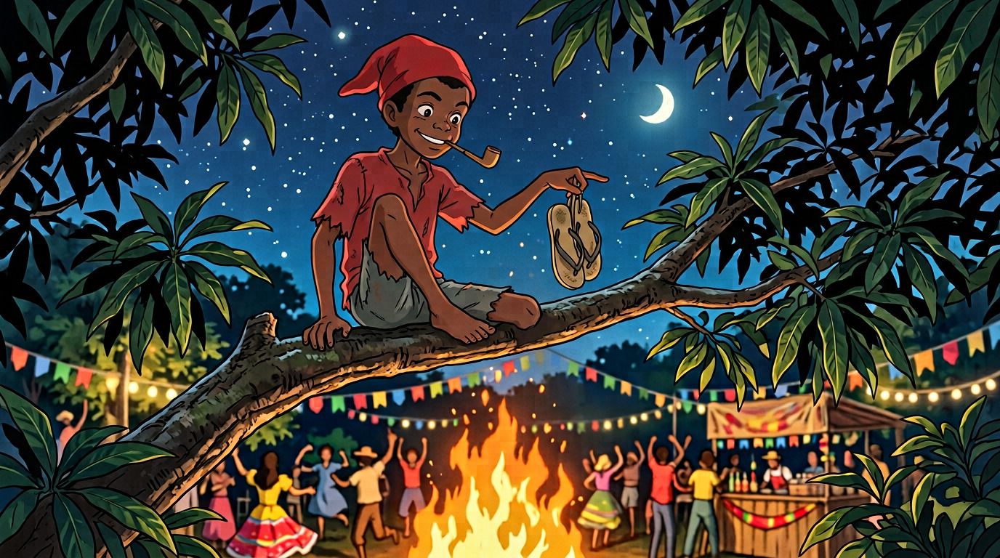

# EPISÓDIO 02 — A FESTA DO BAIRRO
**Formato:** 5 clipes × 6 s = **30 s** (16:9, 24–30 fps)
**Sinopse:** Festa junina do quarteirão. Jesus faz pão de queijo demais, Tupã acende a fogueira com o olhar — e alguém de gorro vermelho começa a roubar os chinelos.

> **Ritmo de 6 s:** cada clipe é uma **ação única** de 6 segundos. O clipe 04 deixou de ter corte interno (não cabe em 6 s): agora é **um tilt down contínuo** do fogo até o chão.

---

## CLIPE 01 — `00:00 – 00:06` | O CONVITE

**Cena:** Muro de quintal azul desbotado, **bandeirinhas coloridas** balançando. A câmera desliza pelo muro até o **cartaz da festa** (sem letras, só desenhos). **Dona Nilza** aparece de repente no quadro e enfia um cartaz na mão de **Jesus**. **Tupã**, atrás, já está com o martelo.
**Câmera:** travelling lateral → para → pequeno reenquadramento para os três.
**Áudio:** sanfona ao longe, risadas. Nilza: *"Hoje tem festa no quintal."* Jesus: *"A gente vai!"*



**Prompt da imagem (frame):**
```text
Muro de quintal em bairro brasileiro, pintado de azul claro desbotado e descascado, decorado com fileiras de bandeirinhas de papel colorido penduradas em cordões. No centro do muro, um cartaz de festa junina colado com fita crepe, ilustrado apenas com desenhos: fogueira, espigas de milho, chapéu de palha, sanfona, corações. Sem nenhuma letra escrita. Luz dourada de fim de tarde, sombras compridas, chão de terra batida com folhas. ESTILO: anime cinematográfico 2D, cel shading limpo, traço fino, fundo pintado à mão no estilo Ghibli x A-1 Pictures, cores quentes e saturadas, grão de filme suave, 16:9, sem texto, sem letreiro, sem logo, sem legenda.
```

**Prompt do vídeo (6 s):** está em **[03-prompts-de-video.md](03-prompts-de-video.md)** → *CLIPE 01* (formato *first & last frame*, com **duas imagens**):
`sequencia/11-ep02-clipe01-A-inicio.jpg` (primeiro frame) + `sequencia/12-ep02-clipe01-B-fim.jpg` (último frame).

---

## CLIPE 02 — `00:06 – 00:12` | A MONTAGEM

**Cena:** Quintal de terra batida. **Jesus** no alto da escada de alumínio, pendurando bandeirinhas e falando com todo mundo. **Tupã** embaixo, segurando a escada com uma mão e o martelo na outra, olhando para cima com paciência de quem já sabe o que vai acontecer.
**Câmera:** contra-plongée, fixo; a escada balança levemente.
**Áudio:** Jesus: *"Tupã, eu nunca me diverti tanto!"* Tupã: *"Desce daí."*



**Prompt da imagem (frame):**
```text
Quintal de terra batida em bairro brasileiro, cordões de bandeirinhas coloridas esticados entre postes e árvores, mesas de plástico e cadeiras de ferro ao fundo, palmeira e muro azul. JESUS: homem brasileiro de 30 anos, pele morena clara, cabelo castanho-escuro cacheado e comprido, na altura dos ombros, preso num coque baixo despojado na nuca, com cachos soltos emoldurando o rosto, barba curta, camisa de linho branca de botão com mangas dobradas, calça jeans clara, chinelo de dedo — em cima de uma escada de alumínio, pendurando bandeirinhas, rindo. TUPÃ: homem indígena de 30 anos, rosto completamente barbeado, sem barba e sem tatuagens nos braços, cabelo preto liso preso em rabo de cavalo baixo, camiseta regata cinza-escura com UMA faixa horizontal de grafismo geométrico guarani atravessada no peito (losangos e zigue-zagues em terracota e preto) e o mesmo motivo pequeno repetido na barra inferior, calça de sarja, sandália de couro — embaixo, segurando a escada com uma mão e um martelo na outra, olhando para cima. Câmera contra-plongée, céu de fim de tarde. ESTILO: anime cinematográfico 2D, cel shading limpo, traço fino, fundo pintado à mão no estilo Ghibli x A-1 Pictures, cores saturadas, grão de filme suave, 16:9, sem texto, sem letreiro, sem logo, sem legenda.
```

**Prompt do vídeo (6 s):** está em **[03-prompts-de-video.md](03-prompts-de-video.md)** → *CLIPE 02* (formato *first & last frame*, com **duas imagens**):
`sequencia/13-ep02-clipe02-A-inicio.jpg` (primeiro frame) + `sequencia/14-ep02-clipe02-B-fim.jpg` (último frame).

---

## CLIPE 03 — `00:12 – 00:18` | PÃO DE QUEIJO INFINITO

**Cena:** Cozinha comunitária. Uma mesa coberta por uma **montanha absurda de pão de queijo** dourados que transborda das bandejas. **Jesus**, com farinha no rosto, as mãos dentro de uma tigela onde a massa **sobe sozinha**, olhos com brilho dourado. Ele ri, sem jeito.
**Câmera:** plano médio frontal, aproximação lenta; farinha suspensa no ar.
**Áudio:** Jesus: *"Eu só queria fazer doze."* Som de massa crescendo.



**Prompt da imagem (frame):**
```text
Cozinha comunitária simples de salão de bairro: azulejo branco, bancada de granilite, forno velho ao fundo. Uma mesa coberta por uma montanha absurda de pão de queijo dourados que transborda das bandejas. JESUS: homem brasileiro de 30 anos, pele morena clara, cabelo castanho-escuro cacheado e comprido, preso num coque baixo na nuca, barba curta, camisa de linho branca com farinha no rosto e nas mãos — mãos dentro de uma tigela de massa que sobe sozinha, olhos com brilho dourado. Farinha no ar como poeira iluminada. ESTILO: anime cinematográfico 2D, cel shading limpo, traço fino, fundo pintado à mão no estilo Ghibli x A-1 Pictures, cores quentes e saturadas, grão de filme suave, 16:9, sem texto, sem letreiro, sem logo, sem legenda.
```

**Prompt do vídeo (6 s):** está em **[03-prompts-de-video.md](03-prompts-de-video.md)** → *CLIPE 03* (formato *first & last frame*, com **duas imagens**):
`sequencia/15-ep02-clipe03-A-inicio.jpg` (primeiro frame) + `sequencia/16-ep02-clipe03-B-fim.jpg` (último frame).

---

## CLIPE 04 — `00:18 – 00:24` | O FOGO E O FURTO

**Cena:** Noite. **Tupã** agachado diante de uma pilha de lenha, mão aberta sobre a madeira — as brasas acendem e a chama sobe devagar, iluminando o rosto dele por baixo. Corte seco dentro do clipe: **close no chão**, dois pares de chinelos, um **redemoinho de poeira** passa e leva os dois. Ao fundo, um **gorro vermelho** some atrás de uma barraca.
**Câmera:** plano baixo fixo no fogo → tilt down contínuo até o chão de terra (sem corte).
**Áudio:** crepitar do fogo, estalo. Depois, um riso agudo curto fora de quadro.



**Prompt da imagem (frame):**
```text
Quintal de festa junina à noite, iluminado por lampiões. No centro, uma pilha alta de lenha apagada. TUPÃ: homem indígena de 30 anos, pele morena, rosto COMPLETAMENTE BARBEADO, sem barba, sem bigode, sem cavanhaque, sem tatuagens nos braços, cabelo preto liso preso em rabo de cavalo baixo, camiseta regata cinza-escura com UMA faixa horizontal de grafismo geométrico guarani atravessada no peito (losangos e zigue-zagues em terracota e preto) e o mesmo motivo pequeno repetido na barra inferior, pulseira de sementes — agachado de frente para a lenha, um joelho no chão, mão aberta sobre a madeira, olhar concentrado. Brasas fracas e fumaça fina sob a lenha, luz laranja subindo por baixo do rosto dele. Bandeirinhas desfocadas ao fundo. ESTILO: anime cinematográfico 2D, cel shading limpo, traço fino, fundo pintado à mão no estilo Ghibli x A-1 Pictures, contraste quente e escuro, grão de filme suave, 16:9, sem texto, sem letreiro, sem logo, sem legenda.
```

**Prompt do vídeo (6 s):** está em **[03-prompts-de-video.md](03-prompts-de-video.md)** → *CLIPE 04* (formato *first & last frame*, com **duas imagens**):
`sequencia/17-ep02-clipe04-A-inicio.jpg` (primeiro frame) + `sequencia/18-ep02-clipe04-B-fim.jpg` (último frame).

---

## CLIPE 05 — `00:24 – 00:30` | O TRATO COM O SACI

**Cena:** No galho alto da mangueira, o **Saci** balança as pernas, com os **dois chinelos pendurados no dedo**, gargalhando. **Tupã** apoia a mão no tronco e olha para cima. **Jesus** ergue um **pão de queijo** como oferenda. O Saci para de rir, inclina o gorro — e desce um galho. **Cartela de título.**
**Câmera:** plano no Saci no galho → tilt down contínuo até a base do tronco.
**Áudio:** riso do Saci, fogueira. Jesus: *"Desce que tem queijo."* Silêncio. Um galho estala.



**Prompt da imagem (frame):**
```text
Noite em quintal de festa junina. No galho alto de uma mangueira frondosa, SACI: menino negro de pele escura, magro, cerca de 12 anos, gorro vermelho pontudo, camisa rasgada, calça curta, um único pé descalço, cachimbo apagado na boca, sorriso travesso — sentado no galho, balançando as pernas, com dois chinelos de dedo pendurados no dedo indicador. Iluminação quente vinda da fogueira abaixo, folhas recortadas contra o céu noturno estrelado. ESTILO: anime cinematográfico 2D, cel shading limpo, traço fino, fundo pintado à mão no estilo Ghibli x A-1 Pictures, cores saturadas, grão de filme suave, 16:9, sem texto, sem letreiro, sem logo, sem legenda.
```

**Prompt do vídeo (6 s):** está em **[03-prompts-de-video.md](03-prompts-de-video.md)** → *CLIPE 05* (formato *first & last frame*, com **duas imagens**):
`sequencia/19-ep02-clipe05-A-inicio.jpg` (primeiro frame) + `sequencia/20-ep02-clipe05-B-fim.jpg` (último frame).

---

## FICHA DO EPISÓDIO 02

| Item | Valor |
|---|---|
| Duração | 30 s (5 × 6 s) |
| Falas | 7 |
| Frames prontos | 5 de 5 ✅ |
| Elenco | Jesus, Tupã, Dona Nilza, Saci |
| Trilha | sanfona + zabumba + triângulo sobre viola de cocho |
| Gancho para o Ep. 03 | o Saci comenta que "o terreno do lado tá triste" |

**Cartela final (edição):**
> **SANTOS DO CERRADO** — Ep. 2: *A Festa do Bairro*
