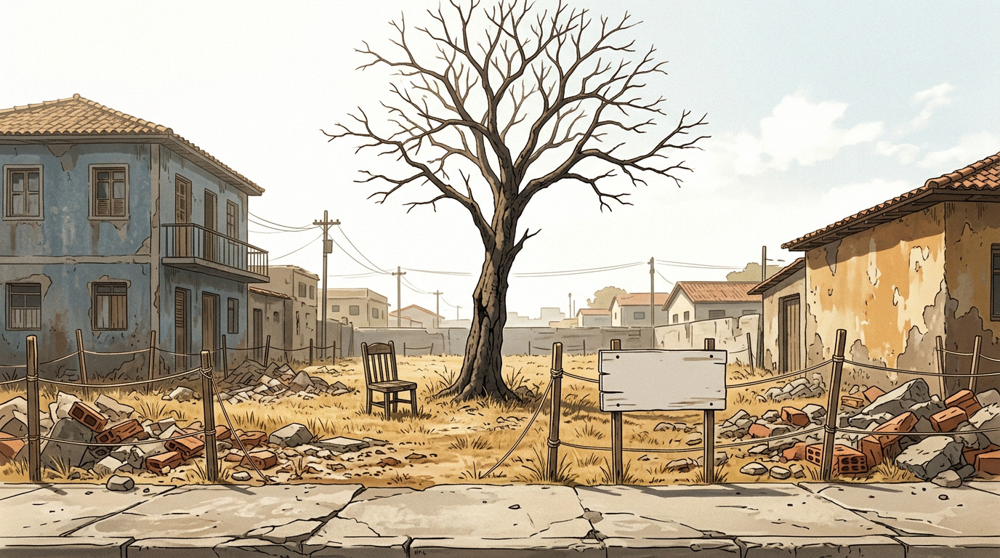
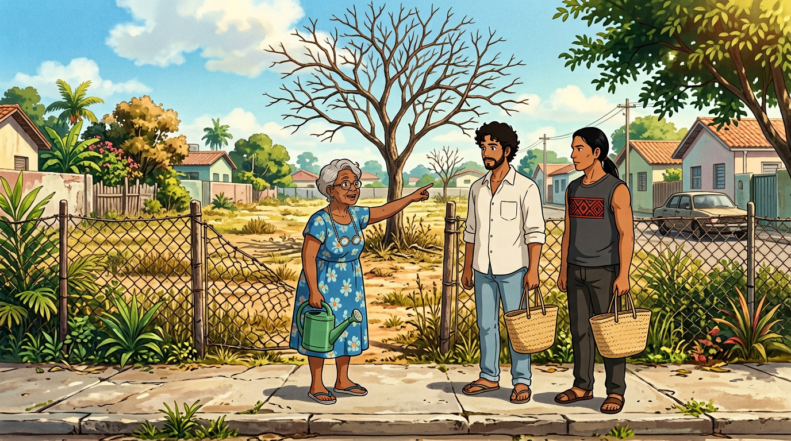
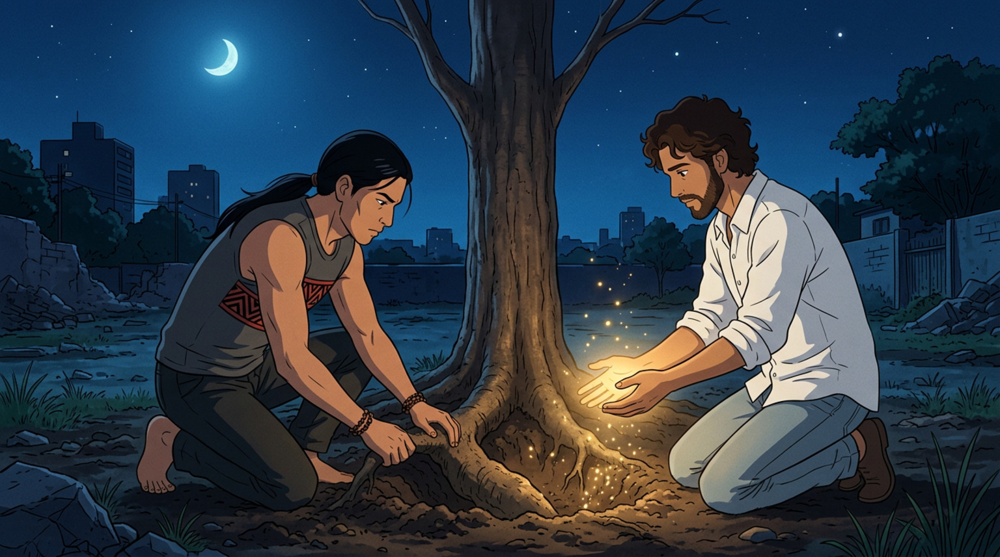
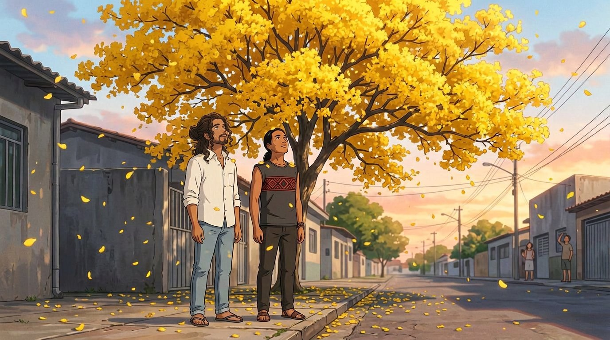

# EPISÓDIO 03 — O IPÊ DO ESTACIONAMENTO
**Formato:** 5 clipes × 6 s = **30 s** (16:9, 24–30 fps)
**Sinopse:** No terreno ao lado do prédio, um ipê de 70 anos está morrendo e vai ser derrubado na semana seguinte. O guardião daquele pedaço de mato não deixa ninguém chegar perto. Jesus e Tupã descobrem que algumas coisas não se resolvem com milagre — se resolvem com água e paciência.

> **Ritmo de 6 s:** cada clipe é uma **ação única**. A virada noite → amanhecer do clipe 04 agora é acelerada: o clipe começa na noite azul e o céu já clareia no último segundo e meio.

---

## CLIPE 01 — `00:00 – 00:06` | A SÍNDICA E A MÁQUINA

**Cena:** Terreno baldio entre dois prédios: capim seco, entulho, **estacas com barbante** e um **ipê completamente nu**. **Dona Nilza** chega com um regador verde e aponta para a árvore. **Jesus** e **Tupã** param na calçada com sacolas de feira.
**Câmera:** travelling lateral lento → para → plano médio dos três.
**Áudio:** vento seco, britadeira distante. Nilza: *"Setenta anos esse ipê. Semana que vem vem a máquina."*



**Prompt da imagem (frame):**
```text
Terreno baldio entre dois prédios baixos em Cuiabá: capim seco amarelado, entulho de construção, tijolos quebrados e uma cadeira velha. No centro, um ipê alto e completamente nu, sem folhas e sem flores, tronco cinza-escuro rachado, galhos secos recortados contra o céu. Na calçada de concreto rachado, uma placa branca lisa sem nenhuma letra e estacas de madeira com barbante esticado demarcando a área. Céu branco de calor. ESTILO: anime cinematográfico 2D, cel shading limpo, traço fino, fundo pintado à mão no estilo Ghibli x A-1 Pictures, paleta seca e desaturada com um leve dourado, grão de filme suave, 16:9, sem texto, sem letreiro, sem logo, sem legenda.
```

**Prompt do vídeo (6 s):**
```text
Travelling lateral lento diante de um terreno baldio com capim seco e entulho, com um ipê nu no centro; a câmera para e DONA NILZA (senhora de 68 anos, cabelo grisalho armado, óculos redondos na corrente, vestido floral azul) entra no quadro segurando um regador de plástico verde e aponta para a árvore. JESUS (camisa de linho branca, cabelo cacheado, barba curta) e TUPÃ (camiseta regata cinza-escura com faixa de grafismo guarani no peito, rosto barbeado, cabelo preto preso) param atrás dela com sacolas de feira de palha, olhando o ipê. O capim se dobra com o vento seco. FALA NILZA: "Setenta anos esse ipê. Semana que vem vem a máquina." SOM: vento seco, britadeira distante, cigarras. ESTILO: anime cinematográfico 2D, cel shading limpo, pintado à mão, paleta seca, 16:9. SEM legenda.
```

---

## CLIPE 02 — `00:06 – 00:12` | OS TRÊS NA CALÇADA

**Cena:** Os três parados na calçada em frente ao terreno. **Dona Nilza** continua falando, com o regador na mão. **Jesus** ouve com atenção, segurando a sacola. **Tupã** está com o olhar fixo na árvore, como quem já escutou alguma coisa.
**Câmera:** plano médio frontal dos três, fixo, leve aproximação.
**Áudio:** Nilza, empolgada: *"Ele dá flor amarela, o bairro inteiro para."* Jesus: *"A gente dá um jeito."* Tupã, baixinho: *"Ele tá com sede."*


**Prompt da imagem (frame):**
```text
Calçada de bairro em Cuiabá, em frente a um terreno baldio com ipê seco ao fundo. Três personagens. DONA NILZA: senhora brasileira de 68 anos, pele parda, cabelo grisalho curto e armado, óculos redondos presos por corrente no pescoço, vestido floral azul, chinelo, segurando um regador de plástico verde e apontando para a árvore. JESUS: homem brasileiro de 30 anos, pele morena clara, cabelo castanho-escuro cacheado e comprido, na altura dos ombros, preso num coque baixo despojado na nuca, com cachos soltos emoldurando o rosto, barba curta, camisa de linho branca de botão com mangas dobradas, calça jeans clara, chinelo de dedo, com uma sacola de feira de palha. TUPÃ: homem indígena de 30 anos, pele morena, rosto COMPLETAMENTE BARBEADO (sem barba, sem bigode, sem cavanhaque), sem tatuagens nos braços, cabelo preto liso na altura dos ombros preso em rabo de cavalo baixo, camiseta regata cinza-escura com UMA faixa horizontal de grafismo geométrico guarani atravessada no peito (losangos e zigue-zagues em terracota e preto) e o mesmo motivo pequeno repetido na barra inferior, calça de sarja escura, sandália de couro, pulseira de sementes, com uma sacola de feira de palha. Luz forte de fim de manhã, sombras curtas. ESTILO: anime cinematográfico 2D, cel shading limpo, traço fino, fundo pintado à mão no estilo Ghibli x A-1 Pictures, cores quentes, grão de filme suave, 16:9, sem texto, sem letreiro, sem logo, sem legenda.
```

**Prompt do vídeo (6 s):**
```text
Plano médio frontal na calçada: DONA NILZA gesticula com o regador verde na direção do ipê seco, falando sem parar; JESUS a ouve balançando a cabeça, com a sacola de feira no braço; TUPÃ está imóvel ao lado, com o olhar preso na árvore, e vira o rosto lentamente para ela. O vento mexe no vestido da síndica e nas folhas secas do chão. Câmera fixa com aproximação leve. FALA NILZA: "Ele dá flor amarela, o bairro inteiro para." FALA JESUS: "A gente dá um jeito." FALA TUPÃ, baixinho: "Ele tá com sede." SOM: trânsito leve, cigarras, sacolas. ESTILO: anime cinematográfico 2D, cel shading limpo, pintado à mão, 16:9. SEM legenda.
```

---

## CLIPE 03 — `00:12 – 00:18` | TUPÃ ESCUTA A ÁRVORE

**Cena:** **Tupã** atravessa o terreno, pisa no capim seco e encosta a **palma aberta no tronco**. Fecha os olhos. O mundo fica em silêncio e um **fio de luz verde** corre pela casca, descendo até a raiz. No galho mais baixo, algo se mexe — e **dois olhos verdes** aparecem entre os galhos secos.
**Câmera:** plano médio lateral, aproximação lenta → tilt up sutil para o galho.
**Áudio:** silêncio absoluto. Depois, um pulso grave embaixo da terra — como um coração batendo devagar. Um estalo de madeira.



**Prompt da imagem (frame):**
```text
Terreno baldio de capim seco. TUPÃ: homem indígena de 30 anos, pele morena, rosto COMPLETAMENTE BARBEADO (sem barba, sem bigode, sem cavanhaque), sem tatuagens nos braços, cabelo preto liso na altura dos ombros preso em rabo de cavalo baixo, camiseta regata cinza-escura com UMA faixa horizontal de grafismo geométrico guarani atravessada no peito (losangos e zigue-zagues em terracota e preto) e o mesmo motivo pequeno repetido na barra inferior, calça de sarja escura, sandália de couro, pulseira de sementes — de pé, com a palma aberta encostada no tronco cinza rachado de um ipê nu, olhos fechados, expressão concentrada. Um fio de luz verde-esmeralda corre pela casca sob a mão dele, descendo em direção ao chão. Poeira suspensa no ar, luz lateral dourada. ESTILO: anime cinematográfico 2D, cel shading limpo, traço fino, fundo pintado à mão no estilo Ghibli x A-1 Pictures, cores saturadas no ponto de luz, grão de filme suave, 16:9, sem texto, sem letreiro, sem logo, sem legenda.
```

**Prompt do vídeo (6 s):**
```text
TUPÃ caminha devagar até o ipê, encosta a palma da mão no tronco rachado e fecha os olhos; um fio de luz verde percorre a casca sob a mão dele e desce em direção ao chão, e a poeira ao redor se afasta. A câmera faz um tilt up sutil até um galho seco mais baixo, onde dois olhos verdes brilhantes se acendem entre os gravetos. Câmera fixa com aproximação leve e tilt up no final. SOM: silêncio total, depois um pulso grave sob a terra, estalo de madeira. SEM FALA. ESTILO: anime cinematográfico 2D, cel shading limpo, pintado à mão, 16:9. SEM legenda.
```

---

## CLIPE 04 — `00:18 – 00:24` | ÁGUA NA RAIZ, LUZ NA TERRA

**Cena:** Noite azul sob a lua. **Tupã** está de joelhos, cavando com as **mãos nuas** ao redor da base do tronco, expondo uma **raiz grossa**. **Jesus**, ao lado, com as **duas mãos abertas sobre a raiz**, deixa uma **luz dourada** escorrer entre os dedos para dentro da terra. Nenhum dos dois fala. Nos clipes anteriores o Curupira já foi visto no galho — aqui ele não aparece: os dois trabalham sozinhos.
**Câmera:** plano médio-alto (plongée leve), fixo. Luz azul e dourada.
**Áudio:** grilos, terra sendo mexida, o pulso grave subterrâneo, mais forte e mais rápido.



**Prompt da imagem (frame):**
```text
Terreno baldio à noite sob luar azul, tronco de ipê no centro. TUPÃ: homem indígena de 30 anos, pele morena, rosto COMPLETAMENTE BARBEADO (sem barba, sem bigode, sem cavanhaque), sem tatuagens nos braços, cabelo preto liso preso em rabo de cavalo baixo, camiseta regata cinza-escura com UMA faixa horizontal de grafismo geométrico guarani atravessada no peito (losangos e zigue-zagues em terracota e preto) e o mesmo motivo pequeno repetido na barra inferior, calça de sarja escura, pulseira de sementes — de joelhos no chão, cavando com as mãos nuas ao redor da base do tronco, expondo uma raiz grossa na terra escura. Ao lado, JESUS: homem brasileiro de 30 anos, pele morena clara, cabelo castanho-escuro cacheado e comprido, na altura dos ombros, preso num coque baixo despojado na nuca, com cachos soltos emoldurando o rosto, barba curta, camisa de linho branca com mangas dobradas, calça jeans clara — de joelhos, com as duas mãos abertas sobre a raiz, uma luz dourada fraca escorrendo entre os dedos para dentro da terra, partículas de luz subindo. Paleta azul noturna com ponto focal dourado. ESTILO: anime cinematográfico 2D, cel shading limpo, traço fino, fundo pintado à mão no estilo Ghibli x A-1 Pictures, grão de filme suave, 16:9, sem texto, sem letreiro, sem logo, sem legenda.
```

**Prompt do vídeo (6 s):**
```text
Noite azul no terreno. TUPÃ cava a terra com as mãos nuas, expondo a raiz do ipê; JESUS, de joelhos ao lado, mantém as duas mãos abertas sobre ela e uma luz dourada escorre entre os dedos e penetra na terra, com partículas subindo devagar. Os dois se olham rapidamente e voltam ao trabalho. Câmera fixa em plongée leve. SOM: grilos, terra sendo revolvida, pulso grave subterrâneo ficando mais forte. SEM FALA. ESTILO: anime cinematográfico 2D, cel shading limpo, pintado à mão, 16:9. SEM legenda.
```

---

## CLIPE 05 — `00:24 – 00:30` | O IPÊ FLORESCE

**Cena:** Amanhecer. **O ipê explode em amarelo** — a árvore inteira. Pétalas caem como neve dourada. O bairro para: carro freia, senhora solta a sacola, cachorro senta. **Jesus** e **Tupã** na calçada, **ombros encostados**, cobertos de pétalas, olhando um para o outro. **Cartela de título.**
**Câmera:** contra-plongée, câmera girando devagar em torno do tronco → para nos dois, de frente.
**Áudio:** trilha cheia. Jesus: *"Ele só precisava de água."* Tupã, baixinho: *"E alguém que visse."*



**Prompt da imagem (frame):**
```text
Plano geral de uma rua de Cuiabá ao amanhecer: um ipê amarelo enorme e florido no centro do quadro, cercado de prédios baixos e cinzentos, calçada e asfalto cobertos de pétalas amarelas. Em primeiro plano, na calçada, EXATAMENTE DUAS pessoas, de ombros encostados, olhando para cima: JESUS (homem brasileiro de 30 anos, pele morena clara, cabelo castanho-escuro cacheado e comprido, na altura dos ombros, preso num coque baixo despojado na nuca, com cachos soltos emoldurando o rosto, barba curta, camisa de linho branca de botão com mangas dobradas, calça jeans clara, chinelo de dedo) e TUPÃ (homem indígena de 30 anos, pele morena, rosto COMPLETAMENTE BARBEADO, sem barba, sem bigode, sem cavanhaque, sem tatuagens nos braços, cabelo preto liso preso em rabo de cavalo baixo, camiseta cinza-escura sem manga com grafismo geométrico guarani em vermelho e preto, calça de sarja escura, sandália de couro, pulseira de sementes). Pétalas no cabelo e nos ombros dos dois. Vizinhos desfocados ao fundo também olhando para cima. Luz de sol nascente atravessando as flores. ESTILO: anime cinematográfico 2D, cel shading limpo, traço fino, fundo pintado à mão no estilo Ghibli x A-1 Pictures, cores luminosas e saturadas, grão de filme suave, 16:9, sem texto, sem letreiro, sem logo, sem legenda.
```

**Prompt do vídeo (6 s):**
```text
Amanhecer. A copa do ipê se abre em flores amarelas e pétalas caem em câmera lenta, cobrindo a rua; a câmera gira devagar em torno do tronco e para de frente para JESUS e TUPÃ, que estão na calçada com os ombros encostados, cobertos de pétalas, e viram o rosto um para o outro sorrindo. Carros param, pessoas olham para cima. FALA JESUS: "Ele só precisava de água." FALA TUPÃ, baixinho: "E alguém que visse." SOM: trilha cheia de viola de cocho, pétalas caindo, "ohhh" coletivo distante. ESTILO: anime cinematográfico 2D, cel shading limpo, pintado à mão, luz de amanhecer, 16:9. SEM legenda.
```

---

## FICHA DO EPISÓDIO 03

| Item | Valor |
|---|---|
| Duração | 30 s (5 × 6 s) |
| Falas | 7 |
| Frames prontos | 5 de 5 ✅ |
| Elenco | Jesus, Tupã, Dona Nilza, Curupira *(aparece no fim do clipe 03)* |
| Trilha | viola de cocho + flauta + percussão leve; entra cheia no florescimento |
| Gancho para a temporada 2 | a figura de terno claro e chapéu de palha, sob a sombra do ipê |

### Onde está o Curupira

Ele é revelado **dentro do clipe 03** (os dois olhos verdes no fim do tilt up). O primeiro plano do Curupira, já em close, está no **clipe 04 do Episódio 02 — "O fogo e o furto"**? Não. Ele está guardado como **frame extra** em `imagens/ep03/alternativas/curupira-galho.jpg` e pode ser usado como **plano de insert** de 2 s no meio do clipe 03, se você quiser dar mais peso à revelação. Fica a seu critério na edição.

> **Alternativa para o clipe 05:** se quiser plantar já o mistério da temporada 2, acrescente ao fim do prompt de vídeo: *"no lado oposto da rua, sob a sombra da árvore, uma figura alta e imóvel de terno claro e chapéu de palha observa; quando a câmera se aproxima, ela desapareceu e só as pétalas giram no lugar."*

**Cartela final (edição):**
> **SANTOS DO CERRADO** — Ep. 3: *O Ipê do Estacionamento*
